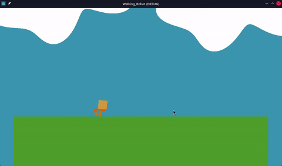

# RL Godot — Ragdoll Reinforcement Learning

A reinforcement-learning playground in **Godot 4** where a ragdoll agent is trained with PPO and the resulting ONNX model runs in-engine in real time.

> **Note:** AI was used heavily throughout development — treat this as an experiment/learning project rather than a from-scratch implementation.

## Demo

## How it works

- The scene uses the **Godot RL Agents** plugin (`addons/`) so a Godot environment can talk to a Python trainer over the usual sync interface.
- `train.py` runs PPO training against the running game.
- Training produces `ragdoll_actor.onnx`, which the `AIcontroller` (C#) loads back into the game to drive the ragdoll live — no Python needed at runtime.
- `export.py` handles exporting a build.

## Reward design

Each step the agent gets:
- forward velocity × 0.2 (move forward)
- cos(torso angle) × 0.1 (stay upright, 1.0 when fully upright)
- a small energy penalty (sum of squared actions × 0.001)
- −1 and an episode reset when the torso touches the ground

Weighting forward movement higher than staying upright made training faster and gave a better final walk. With the upright weight too low (0.01), the agent learned to crawl forward in strange ways, so I raised it to 0.1.

## Layout

- `main.tscn`, `ragdoll.tscn` — environment + ragdoll actor scenes
- `AIcontroller.cs` — inference controller (ONNX runtime)
- `train.py` — PPO training script
- `src/` — environment logic (GDScript)
- `addons/` — Godot RL Agents plugin

## Tech

Godot 4 (.NET), C#, GDScript, Python, ONNX
